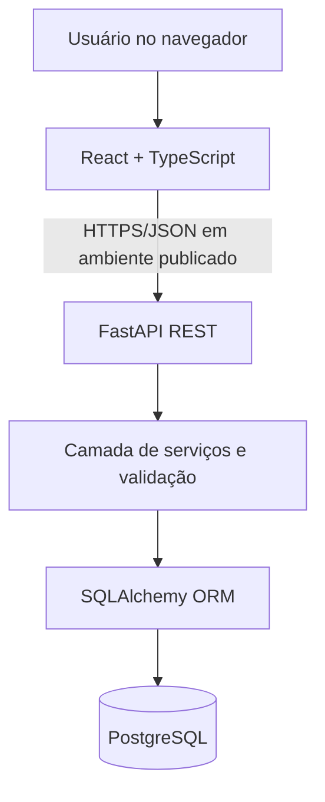

# Arquitetura de solução — ScrumFlow

**Estado:** desenho proposto; não implementado.

## Visão de contexto

## Decisões
- Frontend: React + TypeScript + Vite; componentes e páginas separados de cliente HTTP.
- Backend: FastAPI + Pydantic, rotas finas e regras de negócio em serviços.
- Dados: PostgreSQL, SQLAlchemy 2 e Alembic para migrações versionadas.
- Contrato: REST JSON; OpenAPI gerado e exemplos de erros.
- Organização: monólito modular com dois processos (frontend e backend), evitando microserviços prematuros.
- Ambiente inicial: local, com variáveis de ambiente e dados fictícios; sem credenciais em repositório.

## Entidades propostas
- `Project`: id UUID, name, description, created_at, updated_at.
- `Story`: id UUID, project_id FK, title, description, priority, acceptance_criteria (JSON ou tabela relacionada — decisão antes da implementação), status, sprint_id nullable FK, created_at, updated_at.
- `Sprint`: id UUID, project_id FK, name, goal, start_date, end_date, state, created_at.

**Atenção:** Sprint e campos relacionados podem ser adicionados em migração posterior; Sprint 1 necessita apenas de Project e Story. O campo `status` inicia como `A fazer`. A integridade de projeto entre história e sprint deve ser garantida por regra de negócio e testada.

## API preliminar — Sprint 1
| Método | Rota | Objetivo | Sucesso |
|---|---|---|---|
| POST | `/api/v1/projects` | Criar projeto | 201 |
| GET | `/api/v1/projects` | Listar projetos | 200 |
| GET | `/api/v1/projects/{id}` | Detalhar projeto | 200 |
| PATCH | `/api/v1/projects/{id}` | Editar projeto | 200 |
| POST | `/api/v1/projects/{id}/stories` | Criar história | 201 |
| GET | `/api/v1/projects/{id}/stories` | Listar histórias do projeto | 200 |

Respostas de erro: 404 para recurso inexistente; 422 para payload inválido; 500 sem exposição de stack trace ao usuário. Identificadores UUID. Paginação será considerada antes de uso com volumes elevados, mas não é requisito da Sprint 1.

## Segurança e limites
- Sem autenticação: **somente ambiente local ou demo controlada**. Não publicar API aberta com escrita irrestrita.
- Configurar CORS para origens explicitamente autorizadas.
- Validar dados no backend, mesmo quando validados no frontend.
- Não registrar segredos ou dados sensíveis em logs.
- Variáveis em `.env` local; publicar apenas `.env.example` sem credenciais.
- Migrações com controle de versão; backups se futuramente houver uso real.

## Requisitos não funcionais propostos
- Interface responsiva para desktop e celular.
- Navegação por teclado, rótulos de campos e mensagens de erro acessíveis.
- Erros tratados e comunicados sem falso sucesso.
- Persistência comprovada por testes após recarga.
- Código e contratos documentados.

## Trade-offs
Stack full-stack amplia aprendizado e portfólio, mas aumenta complexidade de setup e integração. Por isso a primeira sprint evita autenticação, dashboards e integrações externas.
